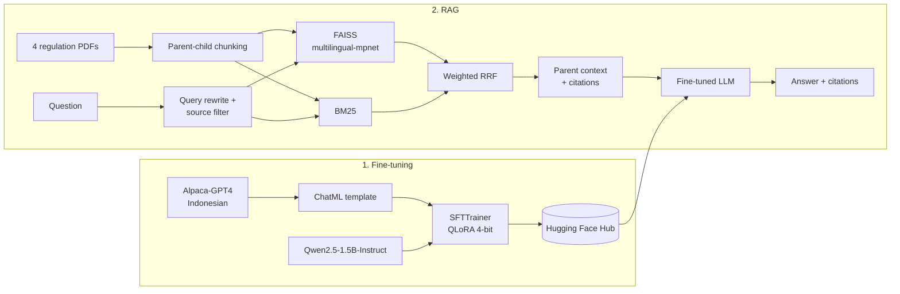
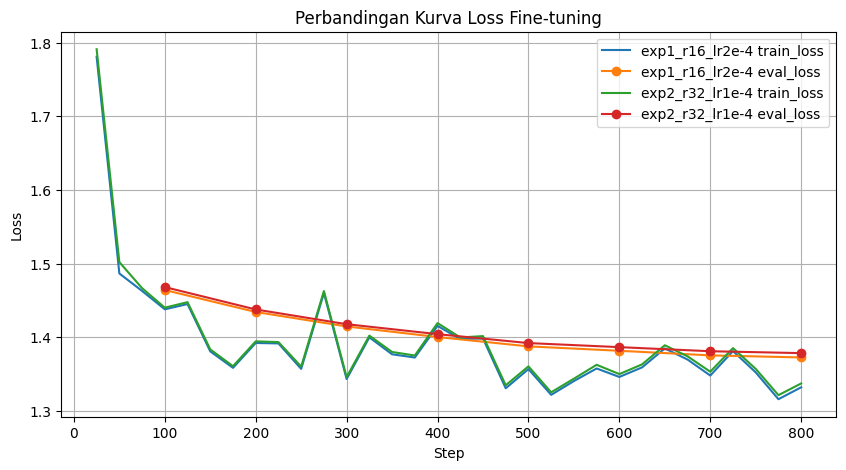

# Indonesian Labor Law RAG with a QLoRA Fine-tuned Qwen2.5


[](https://huggingface.co/dedyirama/qwen2.5-1.5b-indonesian-qlora)

A two-part Generative AI project built on a free Colab T4 GPU:

1. **Fine-tuning:** instruction-tune Qwen2.5-1.5B-Instruct on Indonesian data with QLoRA, compare two hyperparameter configurations, and publish the best model to the Hugging Face Hub.
2. **RAG:** use that model to answer questions about Indonesian labor regulations, with hybrid retrieval over ~1,950 pages of law and page-level citations.

This was my final project for Dicoding Academy's *Pengembangan Generative AI berbasis LLM* (Generative AI Development with LLMs) course. The notebooks and their comments are in Indonesian.

| Notebook | What it covers | Colab |
| --- | --- | --- |
| [01_fine_tuning_qlora.ipynb](notebooks/01_fine_tuning_qlora.ipynb) | QLoRA fine-tuning, two experiments, merge and push to the Hub | [](https://colab.research.google.com/github/dedyirama-id/indonesian-labor-law-rag/blob/main/notebooks/01_fine_tuning_qlora.ipynb) |
| [02_rag_legal_assistant.ipynb](notebooks/02_rag_legal_assistant.ipynb) | Document ingestion, hybrid retrieval, cited generation, Gradio demo | [](https://colab.research.google.com/github/dedyirama-id/indonesian-labor-law-rag/blob/main/notebooks/02_rag_legal_assistant.ipynb) |

## Architecture



## Part 1: Fine-tuning

| | |
| --- | --- |
| Base model | `unsloth/Qwen2.5-1.5B-Instruct-bnb-4bit` |
| Dataset | [`Ichsan2895/alpaca-gpt4-indonesian`](https://huggingface.co/datasets/Ichsan2895/alpaca-gpt4-indonesian): 49,969 general-purpose instruction/response pairs, split 95/5 into train (47,470) and validation (2,499) |
| Method | QLoRA: 4-bit NF4 with double quantization; LoRA adapters on all attention and MLP projections |
| Training | TRL `SFTTrainer`, 800 steps (~0.13 epoch), effective batch size 8, `adamw_8bit`, single Tesla T4 |
| Output | Best adapter merged to 16-bit and published as [`dedyirama/qwen2.5-1.5b-indonesian-qlora`](https://huggingface.co/dedyirama/qwen2.5-1.5b-indonesian-qlora) |

The fine-tuning goal is better Indonesian instruction following in general. The model was **not** trained on legal text; domain knowledge comes from retrieval in Part 2.

### Experiments

| Run | LoRA r / alpha | Learning rate | Trainable params | Final validation loss |
| --- | --- | --- | --- | --- |
| `exp1_r16_lr2e-4` (selected) | 16 / 16 | 2e-4 | 18.5M (1.18%) | **1.3726** |
| `exp2_r32_lr1e-4` | 32 / 32 | 1e-4 | 36.9M (2.34%) | 1.3784 |



Both runs converge almost identically. Run 1 finished with a slightly lower validation loss while training half as many parameters, so it was the one published. The 0.006 gap comes from a single run per configuration, and rank and learning rate were changed together, so it does not show that either setting is better on its own.

## Part 2: Retrieval-Augmented Generation

**Corpus:** four Indonesian regulations totalling 1,949 pages: UU 6/2023 (Job Creation Law), PP 35/2021 (employment contracts, working hours, termination), PP 5/2021 (risk-based business licensing), and PP 51/2023 (wages). See [data/README.md](data/README.md).

| Stage | Implementation |
| --- | --- |
| Ingestion | `PyPDFLoader`, adding metadata for document type, number, year, and page |
| Chunking | Parent-child: 700-character children are indexed for search and their 1,800-character parents are passed to the LLM (4,257 children, 1,992 parents) |
| Retrieval | FAISS with `paraphrase-multilingual-mpnet-base-v2` (weight 0.6) and BM25 (weight 0.4), fused with weighted Reciprocal Rank Fusion |
| Query handling | Keyword-based rewriting and a source filter that routes wage and overtime questions to PP 35/2021 |
| Generation | Grounded system prompt, prompt trimmed to a token budget, greedy decoding with repetition penalties, and a fallback message when the output is degenerate |
| Output | Answer with citations in the form `[n] <document> page <x>`, served through a Gradio interface |

### Example: retrieval for an overtime question

> *"Saya staf admin, kemarin lembur 3 jam untuk beresin laporan. Apakah saya berhak dapat uang lembur?"*
> (I'm an admin staffer and worked 3 hours of overtime yesterday. Am I entitled to overtime pay?)

The retriever returns PP 35/2021 pages 3, 19, and 20. Page 3 contains the legal definitions of overtime hours (*Waktu Kerja Lembur*) and overtime pay (*Upah Kerja Lembur*); pages 19 and 20 contain the rules for calculating overtime pay.

**Note on this example:** for overtime questions where PP 35/2021 is retrieved, the final answer comes from a fixed template that cites the retrieved pages. The fine-tuned model does not generate it. All other questions go through model generation.

## Limitations

- **No quantitative RAG evaluation.** Retrieval was checked by hand on test questions; no retrieval metrics (e.g. recall@k) or answer-faithfulness scores were measured.
- **Narrow query handling.** The rewriting rules and source filter are hand-written for wage and overtime questions. Other topics rely on plain hybrid retrieval.
- **Small generator.** A 1.5B model can produce unstable or repetitive answers, which is why the template and degenerate-output fallback above exist.
- **No baseline comparison.** The fine-tuned model was not benchmarked against the base Qwen2.5-1.5B-Instruct.
- This is a learning project and does not provide legal advice.

## Possible next steps

- Build a small labeled question set and measure retrieval recall@k and answer faithfulness (e.g. with RAGAS).
- Replace the rule-based routing with metadata-aware retrieval or a cross-encoder reranker.
- Compare the base model, the fine-tuned model, and a larger model as the generator, and remove the template.

## Running the notebooks

Both notebooks target **Google Colab with a T4 GPU** and use `/content` as the working directory.

1. Open a notebook with its Colab badge.
2. Add your Hugging Face token to **Colab Secrets** as `HF_TOKEN`. A write token is only needed to push the model in notebook 01. If no secret is found, the notebook asks for the token.
3. Run all cells. Notebook 02 downloads the four PDFs to `/content/data` and loads the fine-tuned model from the Hub, so you do not need to run notebook 01 first.

The dependencies are listed in [requirements.txt](requirements.txt).

## Repository structure

```
├── notebooks/
│   ├── 01_fine_tuning_qlora.ipynb
│   └── 02_rag_legal_assistant.ipynb
├── assets/loss_curve.png
├── data/README.md          # source documents (PDFs are not committed)
└── requirements.txt
```
